<p align="center">
  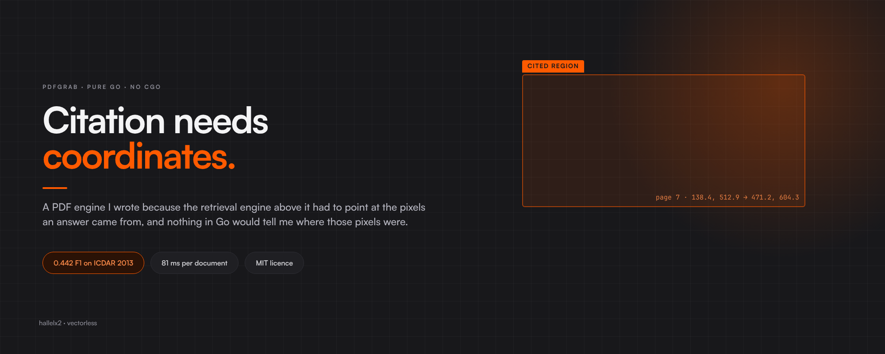
</p>

<p align="center">
  <strong>A pure-Go port of pdfplumber.</strong><br/>
  pdfgrab reads a PDF's content streams and returns every character, word, line, rectangle and table cell together with the rectangle it occupies on the page. No CGo, no Python, MIT.
</p>

<p align="center">
  <a href="https://pkg.go.dev/github.com/hallelx2/pdfgrab"></a>
  <a href="LICENSE"></a>
  <a href="go.mod"></a>
  
  
  
</p>

<p align="center">
  <a href="#status">Status</a> ·
  <a href="#why-it-exists">Why</a> ·
  <a href="#quick-start">Quick start</a> ·
  <a href="#how-it-works">How it works</a> ·
  <a href="#benchmarks">Benchmarks</a> ·
  <a href="#agreement-with-pdfplumber">Agreement with pdfplumber</a> ·
  <a href="#limits">Limits</a> ·
  <a href="#api">API</a> ·
  <a href="#cli">CLI</a>
</p>

---

## Status

pdfgrab was written for [Vectorless](https://github.com/hallelx2/vectorless-engine). The hosted Vectorless service is closing (decided 2026-10-11), and pdfgrab, like the rest of the project, is open source and no longer actively developed. Issues and pull requests may not get a reply. For anything else, write to halleluyaholudele@gmail.com.

All four pdfplumber table strategies are implemented (`lines`, `lines_strict`, `text`, `explicit`) and can be mixed per axis. There is also an opt-in `auto` strategy, opt-in text-edge region detection and a `pdfgrab` CLI.

## Why it exists

A retrieval system that answers from a PDF usually cites a page. A page of a 10-K can hold eleven paragraphs and a table, so the reader still has to search it for the sentence that was used. To draw a box around that sentence, the system needs the coordinates of every word, and it needs them from ingest onwards. Chunking a document into fixed-size text pieces discards them, and nothing later in the pipeline can put them back.

Vectorless keeps the document whole, picks sections, and highlights the exact lines an answer came from. That needed a PDF layer in Go that keeps every coordinate. When the Go field was compared on 2026-09-17, the options were these:

- `pdfcpu` handles objects, the cross-reference table and decompression, and does not extract text.
- `ledongthuc/pdf`, `rsc.io/pdf` and `dslipak/pdf` give text with positions and no table structure.
- `klippa-app/go-pdfium` gives per-character boxes, runs without CGo in its WebAssembly mode, and has no table layer.
- `unidoc/unipdf` v5 has the best table output in Go, with a box and grid indices per cell, and is commercial-licence-only.
- `coregx/gxpdf` (MIT) extracts tables and scored 0.179 F1 in the [2026-09-17 field comparison](docs/evaluations/2026-09-17-field-comparison-and-metric-correction.md).

Python has had pdfplumber since 2018. pdfgrab is a port of it, built on pdfcpu for the object layer, so a Go service can read a PDF's geometry in-process.

<p align="center">
  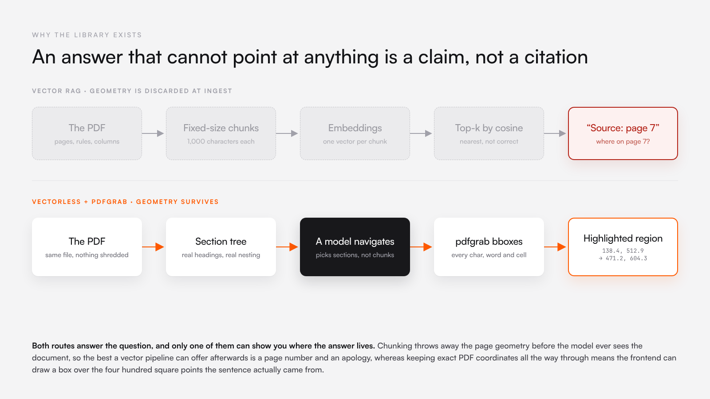
</p>

## Quick start

```sh
go get github.com/hallelx2/pdfgrab@main
```

Use `@main`. Every tag from `v0.0.1` to `v0.4.0` was cut before the module was renamed from `github.com/hallelx2/pdftable`, so `go get github.com/hallelx2/pdfgrab@v0.4.0` fails with a module path mismatch (HAL-2690). pdfgrab needs Go 1.25 or later.

```go
package main

import (
	"fmt"
	"log"
	"os"

	"github.com/hallelx2/pdfgrab"
)

func main() {
	doc, err := pdfgrab.OpenFile(os.Args[1])
	if err != nil {
		log.Fatal(err)
	}
	defer doc.Close()

	page, err := doc.Page(1)
	if err != nil {
		log.Fatal(err)
	}

	// Every word, with its rectangle in PDF points.
	words, err := page.Words(pdfgrab.DefaultWordOpts())
	if err != nil {
		log.Fatal(err)
	}
	for _, w := range words[:min(5, len(words))] {
		fmt.Printf("%-16q x0=%.2f y0=%.2f x1=%.2f y1=%.2f\n", w.Text, w.X0, w.Y0, w.X1, w.Y1)
	}

	// Every table, with one rectangle per cell.
	tables, err := page.ExtractTables(pdfgrab.DefaultTableSettings())
	if err != nil {
		log.Fatal(err)
	}
	for _, t := range tables {
		for i, row := range t.Rows {
			for j, cell := range row {
				b := t.CellsBBox[i][j]
				// Fractions of the page, origin top-left: ready for a CSS overlay.
				r := b.Normalized(page.Width(), page.Height())
				fmt.Printf("%-12q left=%.3f top=%.3f w=%.3f h=%.3f\n", cell, r.Left, r.Top, r.Width, r.Height)
			}
		}
	}
}
```

Run on [`testdata/table-2x3-ruled.pdf`](testdata/table-2x3-ruled.pdf) (output captured 2026-10-12):

```text
"Name"           x0=110.00 y0=675.93 x1=136.67 y1=685.93
"Age"            x0=210.00 y0=675.93 x1=227.79 y1=685.93
"Alice"          x0=110.00 y0=645.93 x1=131.67 y1=655.93
"30"             x0=210.00 y0=645.93 x1=221.12 y1=655.93
"Bob"            x0=110.00 y0=615.93 x1=127.79 y1=625.93
"Name"       left=0.163 top=0.116 w=0.163 h=0.038
"Age"        left=0.327 top=0.116 w=0.163 h=0.038
"Alice"      left=0.163 top=0.154 w=0.163 h=0.038
"30"         left=0.327 top=0.154 w=0.163 h=0.038
"Bob"        left=0.163 top=0.192 w=0.163 h=0.038
"25"         left=0.327 top=0.192 w=0.163 h=0.038
```

Word coordinates are PDF user space: points, origin at the bottom-left, Y growing up. The cell rectangles are converted to viewer space: fractions of the page, origin at the top-left, Y growing down.

## How it works

A PDF page stores drawing instructions, not text. pdfgrab replays those instructions, records where each glyph and line lands, and rebuilds words, lines and tables from the positions. Each stage below names the file that does it.

```text
bytes ─ pdfcpu ─▶ objects, fonts, content streams      internal/pdf/reader.go
      ─ interpreter ─▶ Char, Line, Rect, Curve         internal/pdf/content.go, ops.go, state.go, font.go, cmap.go
      ─ grouping ─▶ Word, text                         text.go, clustering.go
      ─ edges, intersections, cells ─▶ Table           page.go, finder.go, finder_text.go, internal/layout/lines.go
      ─ BBox.Viewport / Normalized ─▶ ViewRect         geometry.go
```

### 1. Content streams and operators

pdfcpu parses the file: the cross-reference table, indirect objects, stream decompression, and decryption when the user password is empty. pdfgrab takes each page's content stream from there and runs its own interpreter over it, modelled on pdfminer.six.

<p align="center">
  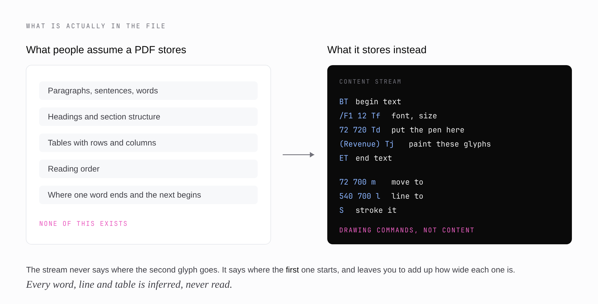
</p>

A lexer splits the stream into operands and operators. A dispatch table in [`internal/pdf/ops.go`](internal/pdf/ops.go) maps every operator in PDF 1.7 §A.2 to a handler, so the operand stack stays balanced even for operators pdfgrab ignores, such as colour. The handlers that matter:

| Operators | What pdfgrab does with them |
|---|---|
| `q` `Q` `cm` | Push, pop and concatenate the graphics state and its current transformation matrix (CTM). |
| `m` `l` `c` `v` `y` `h` `re` | Build a path. |
| `S` `s` `f` `F` `f*` `B` `B*` `b` `b*` `n` | Paint (or discard) the path. A single `re` becomes a `Rect`, a chain of straight segments becomes `Line`s, anything else a `Curve`, each with stroke and fill flags. |
| `BT` `ET` `Tf` `Tc` `Tw` `Tz` `TL` `Ts` `Tr` | Begin and end text, and set the text state: font, size, character and word spacing, horizontal scale, leading, rise. |
| `Td` `TD` `Tm` `T*` | Move the text matrix. |
| `Tj` `TJ` `'` `"` | Show glyphs. In a `TJ` array each number shifts the next glyph left by number/1000 of the font size. |
| `Do` | Run a Form XObject's own content stream in a sub-interpreter under its `/Matrix`, with its own resources. Image XObjects are skipped. |

Before the stream runs, the CTM is set so that the MediaBox's lower-left corner is (0,0) and any `/Rotate` is already applied. Every coordinate pdfgrab reports is therefore in the space of `Page.Width()` by `Page.Height()` as a viewer would display it.

### 2. Text state and font metrics

A content stream gives the starting point of a run of text. It does not say where the second glyph goes. That position is the first glyph's position plus its advance width, and so on along the line, so one wrong width shifts every glyph after it.

For each glyph, `showString` in [`internal/pdf/content.go`](internal/pdf/content.go) does this:

1. Combine the text matrix with the CTM.
2. Build the glyph box in text space: from 0 to the advance width horizontally, and from the font's descent to descent plus font size vertically, shifted by the rise.
3. Transform the box to page space and emit a `Char` with its text, font name, size, an `Upright` flag and the advance.
4. Move the text matrix by the advance, plus character spacing, plus word spacing when the byte is a space in a simple font.

The advance width comes from the font's `/Widths` array. PDF 1.7 lets the 14 standard fonts (Helvetica, Times, Courier, Symbol, ZapfDingbats and their variants) omit `/Widths`, because a reader is expected to know them. Before 0.5.0 pdfgrab did not, and fell back to 500/1000 of the size for every glyph, so `i` (222) and `m` (833) came out the same width.

<p align="center">
  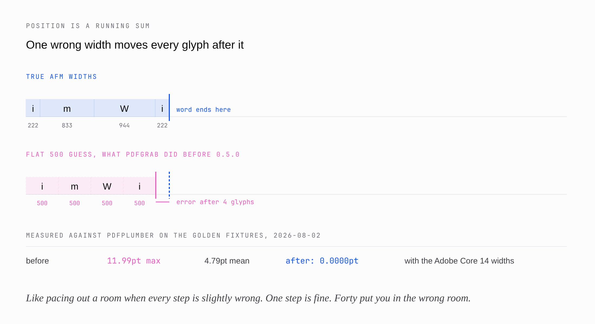
</p>

pdfgrab now bundles the Adobe Core 14 AFM widths, ascents and descents ([`internal/pdf/afm_widths.go`](internal/pdf/afm_widths.go), [`afm_vmetrics.go`](internal/pdf/afm_vmetrics.go)). The lookup order for a width is: the font's own `/Widths`, then the bundled Core 14 table by Unicode, then the font's default width, then 500. Common substitute names such as `Arial`, `Times New Roman` and `Courier New` alias to their Core 14 equivalents. Narrow and Condensed variants do not alias, because they share a family name and not the metrics.

The vertical box had two faults of its own, fixed in the same work. The standard-14 exemption that omits `/Widths` also omits `/FontDescriptor`, so the descent was 0; and the descent was scaled by 0.001 but not by the font size. Glyph boxes sat exactly 0.207 × size too high in Helvetica: 2.484 pt at 12 pt, 4.968 pt at 24 pt ([2026-08-02 report](docs/evaluations/2026-08-02-font-metrics-and-table-fidelity.md)). Row boundaries in the `text` and `lines_strict` strategies come from word extents, so this was a table bug as well as a highlight bug.

### 3. Encodings and ToUnicode

The bytes in a `Tj` string are character codes, not characters.

<p align="center">
  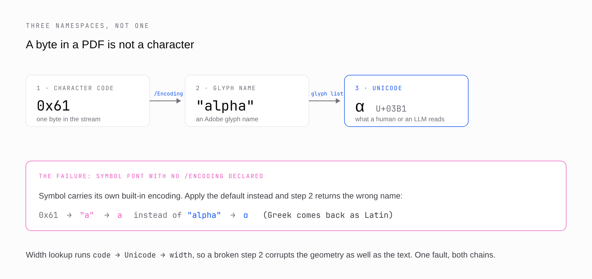
</p>

[`internal/pdf/font.go`](internal/pdf/font.go) turns codes into text in this order:

1. **Codes.** A simple font (Type1, TrueType) uses one byte per code. A composite (Type0) font is read as two-byte big-endian codes, which is the `Identity-H` layout.
2. **ToUnicode first.** If the font has a `/ToUnicode` CMap ([`internal/pdf/cmap.go`](internal/pdf/cmap.go) parses `bfchar` and `bfrange`), it wins, as PDF 1.7 §9.10.2 requires. It is often the only way ligature glyphs map back to `fi` or `ffi`.
3. **Encoding.** Otherwise a simple font's base encoding (StandardEncoding, WinAnsiEncoding, MacRomanEncoding or PDFDocEncoding), overlaid with its `/Differences` array, gives a glyph name. The Adobe Glyph List turns the name into Unicode, including `uniXXXX` names and compound names such as `f_i`.
4. **Fallbacks.** Printable ASCII bytes in a simple font fall back to Latin-1. Anything else becomes `(cid:N)`, the same placeholder pdfminer.six uses, and keeps its box.

Symbol and ZapfDingbats carry their own built-in encodings and do not declare `/Encoding`. pdfgrab used to hand them StandardEncoding, so Symbol's `0x61` came out as `a` instead of `α`. They now decode with their own tables. pdfplumber 0.11.9 still has this defect (2026-08-02). Because the Core 14 width lookup goes through Unicode, a wrong glyph name broke the width as well as the text.

### 4. Chars to words to lines

[`text.go`](text.go) is a port of pdfplumber's `WordExtractor` and `extract_text`.

1. Drop characters with no text. Whitespace characters are dropped too, unless `UseExplicitSpaces` keeps them as word boundaries.
2. Group characters by orientation (and by font name or size, if `ExtraAttrs` asks for it).
3. Cluster each group into lines by the top of the glyph, within `YTolerance` (3 pt by default). Rotated text clusters by X instead.
4. Sort each line in reading direction (`ltr`, `rtl`, `ttb` or `btt`) and walk it. A new word starts at an explicit space glyph, or where the gap to the previous glyph exceeds `XTolerance` (3 pt), or `XToleranceRatio` × the font size when that ratio is set.
5. Join the characters, expanding ligatures such as `fi` to `fi`. The word's box is the union of its characters' boxes.

`DefaultWordOpts()` sets `UseExplicitSpaces`, as pdfplumber does. Without it, 8 pt text merged into single words: an 8 pt space is 278/1000 × 8 = 2.22 pt wide, under the 3 pt tolerance. `DefaultTextOpts()` also sets `XToleranceRatio` to 0.15, so the word gap is 1.5 pt at 10 pt and 3.6 pt at 24 pt.

`ExtractText` joins words with spaces and lines with newlines. With `Layout: true` it places text on a character grid (`XDensity` 7.25 pt per character, `YDensity` 13 pt per line), like `pdftotext -layout`.

### 5. Viewer space and the coordinate flip

Every box pdfgrab reports is in PDF user space: origin at the bottom-left, Y growing up, in points. Browsers, canvases, SVG and PDF.js put the origin at the top-left with Y growing down. A highlight drawn with the wrong convention lands upside down on the page.

[`geometry.go`](geometry.go) does the flip in one place and gives the result its own type, `ViewRect`, so the two spaces cannot be mixed up at a call site:

```go
b := t.CellsBBox[row][col] // BBox: PDF user space

// Pixels, for a page rendered at 150 DPI (or the scale passed to PDF.js getViewport).
r := b.Viewport(page.Height(), 150.0/72.0)
// left: r.Left, top: r.Top, width: r.Width, height: r.Height

// Fractions of the page, 0 to 1, which stay correct when the viewer resizes.
n := b.Normalized(page.Width(), page.Height())
```

`Viewport` computes `top = (pageHeight − Y1) × scale`. `Normalized` divides by the page size and returns a zero `ViewRect` instead of NaN when a dimension is not positive. The 2026-08-02 audit checked this geometry by projecting real cell boxes onto pages rendered with `pdftoppm` and confirming that the highlights landed on the intended rows.

### 6. Tables

A table is not stored in a PDF either. It is inferred from rules and from how text lines up. `ExtractTables` runs pdfplumber's `TableFinder` pipeline: derive edges, snap and join them, find where they cross, build cells from crossings, group cells into tables, then fill each cell with text.

<p align="center">
  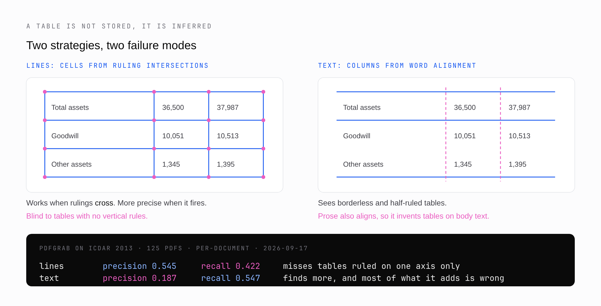
</p>

Each axis picks where its edges come from:

| Strategy | Edges come from | Use it when |
|---|---|---|
| `lines` (default) | Drawn lines, all four sides of every rectangle, axis-aligned curve segments | The table has rules on both axes. |
| `lines_strict` | Drawn lines only | Cell backgrounds are filled rectangles you do not want read as row boundaries. |
| `text` | Clusters of words that share a left edge, right edge or centre (columns, at least `MinWordsVertical` = 3 words) or a top (rows, at least `MinWordsHorizontal` = 1) | The table has no rules. |
| `explicit` | `ExplicitVerticalLines` and `ExplicitHorizontalLines`, at least two per axis | You already know the grid, for example from a layout model. |
| `auto` (opt-in) | `lines` on an axis that has rulings; `text` on an axis without them only if the other axis is ruled; otherwise nothing | The corpus has tables ruled on one axis only. |

```go
s := pdfgrab.DefaultTableSettings()
s.VerticalStrategy = pdfgrab.StrategyText    // columns from word alignment
s.HorizontalStrategy = pdfgrab.StrategyLines // rows from drawn rules
tables, err := page.ExtractTables(s)
```

The rest of the pipeline, in [`page.go`](page.go), [`finder.go`](finder.go) and [`internal/layout/lines.go`](internal/layout/lines.go):

1. **Edges.** Drop raw edges shorter than `EdgeMinLengthPrefilter` (1 pt). Snap near-collinear edges within `SnapTolerance` (3 pt) onto their mean, join collinear pieces within `JoinTolerance` (3 pt), and drop merged edges shorter than `EdgeMinLength` (3 pt). Explicit lines are added on top of derived ones for every strategy except `explicit`, where they are the only edges.
2. **Intersections.** Every crossing of a vertical and a horizontal edge, with `IntersectionTolerance` (3 pt) of slack.
3. **Cells.** From each intersection, the smallest rectangle whose four corners are intersections joined by shared edges.
4. **Tables.** Connected groups of cells, sorted top to bottom, each with a grid of cell boxes.
5. **Text.** A glyph belongs to the cell that contains its centre. The cell's words are extracted with `TextTolerance` (3 pt) and trimmed. The result is `Table.Rows` (`[][]string`, missing cells are `""`) and `Table.CellsBBox`, one box per cell.

Two guards stop pathological pages: more than `MaxEdgesPerAxis` (1000) merged edges on an axis, or more than `MaxIntersections` (50,000) crossings, skips table finding for that page with a logged warning. `FindTables` returns the intermediate edges, intersections and cells without the text step, for debugging.

`MergeSplitTokens` (off by default) rejoins two cells when the column boundary between them cuts through a single word, as `text` columns sometimes do: `(16,135)` read as `(` and `16,135)`. pdfplumber produces the same splits, so turning it on by default would break parity.

`DetectRegions` (off by default) restricts the `text` strategy to regions found by Anssi Nurminen's text-edge method, the one camelot's `stream` flavour uses: a column exists only where at least 4 vertically adjacent lines share an alignment. Prose shares a left margin but its interior positions wander, so it rarely passes. `DetectTextEdgeRegions` exposes the detector on its own. The results are under [negative results](#negative-results).

#### The 0.008 pt that flipped a sign

Assigning a glyph to the cell that holds its centre is right at an interior boundary, where two cells compete for a glyph that straddles them. At the table's outer edge there is no neighbour, and the same rule deletes the glyph.

<p align="center">
  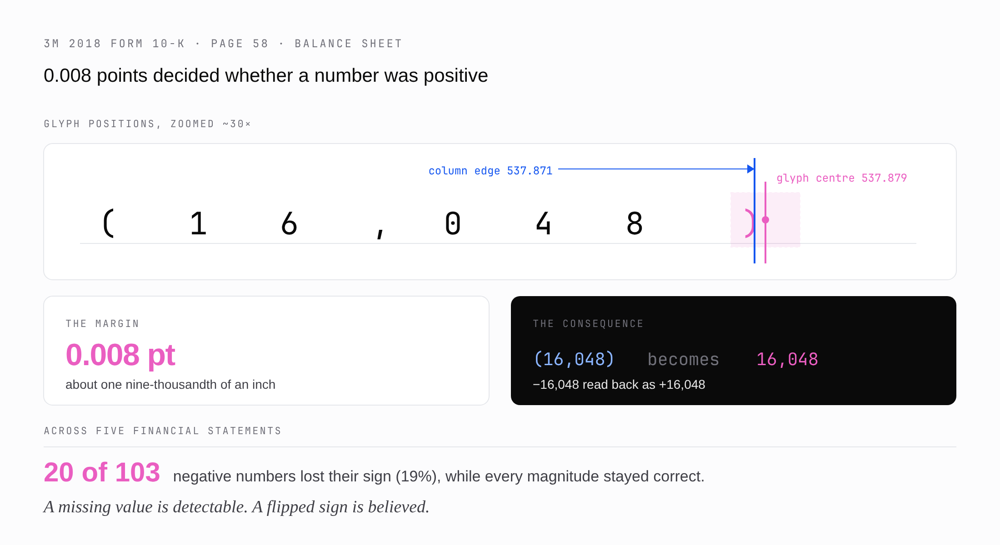
</p>

On page 58 of 3M's 2018 Form 10-K, the `)` of `(16,048)` has its centre at x = 537.879 and the last column ends at x = 537.871. The parenthesis was dropped, and accounting notation for −16,048 came back as 16,048. Across the filing's five financial statements (pages 56 to 60) this flipped the sign of 20 of 103 negative numbers while every magnitude stayed correct. pdfplumber has the same defect and returns `16,048` for that row (2026-08-02).

The fix is `charsInCellEdges` in [`page.go`](page.go): on a table's outer left or right edge, a cell also keeps a glyph that overlaps the edge even when its centre falls outside. The widening is bounded by the glyph itself, so it cannot pull in unrelated text. Minus signs kept went from 83/103 to 103/103.

### 7. The hybrid: a layout model gives the grid, pdfgrab reads the cells

The [ICDAR 2013 results](#benchmarks) put most of pdfgrab's error in finding tables and their rows and columns, not in reading cells. An oracle experiment on 2026-08-03 measured how much is left once the grid is right. It gave the `explicit` strategy the correct column and row boundaries from the ground truth and scored the output.

<p align="center">
  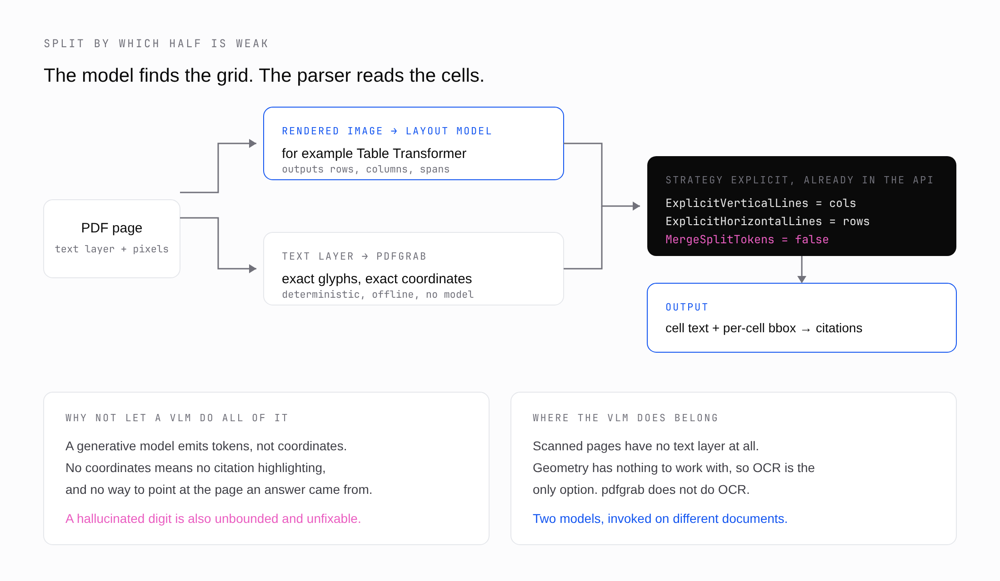
</p>

| Configuration (107 single-region PDFs, pooled F1) | Precision | Recall | F1 |
|---|---|---|---|
| pdfgrab `lines`, finding the grid itself | 0.865 | 0.229 | 0.362 |
| pdfgrab `explicit` with the correct grid | 0.948 | 0.922 | **0.935** |
| The same, with `MergeSplitTokens` on | 0.806 | 0.660 | 0.726 |

So a model that outputs rows and columns, such as Table Transformer, would supply what pdfgrab lacks, while pdfgrab keeps what a generative model cannot give: the exact cell text and the exact cell coordinates. The integration point is already in the API, and pdfgrab makes no model or network call itself:

```go
s := pdfgrab.DefaultTableSettings()
s.VerticalStrategy = pdfgrab.StrategyExplicit
s.HorizontalStrategy = pdfgrab.StrategyExplicit
s.ExplicitVerticalLines = colBoundaries   // x positions in PDF points, from the layout model
s.ExplicitHorizontalLines = rowBoundaries // y positions in PDF points
s.MergeSplitTokens = false                // the default; keep it off with a supplied grid
tables, err := page.ExtractTables(s)
```

Keep `MergeSplitTokens` off with a supplied grid. It exists to repair columns that a geometric guess cut through a value. With a correct grid there is nothing to repair, and every merge destroys a correct cell: F1 fell from 0.935 to 0.726.

What this does not show: no layout model was run. The grid came from the ground truth, so 0.935 is a ceiling for the hybrid, not a measurement of one. The F1 is pooled over 107 single-region documents, which is a different metric and corpus from the 0.442 end-to-end figure below. Pages with several tables were excluded.

## Benchmarks

Every figure links to the dated report that measured it. All reports are in [docs/evaluations](docs/README.md).

### ICDAR 2013, end to end (2026-09-17)

The corpus is the ICDAR 2013 Table Competition set in Smock's corrected edition: 125 born-digital PDFs and 39,524 ground-truth adjacency relations. Each system has to find every table and grid it. The score is adjacency-relation F1 averaged per document, the competition's own aggregation. The harness is [`bench/icdar2013`](bench/icdar2013/), a separate Go module.

<p align="center">
  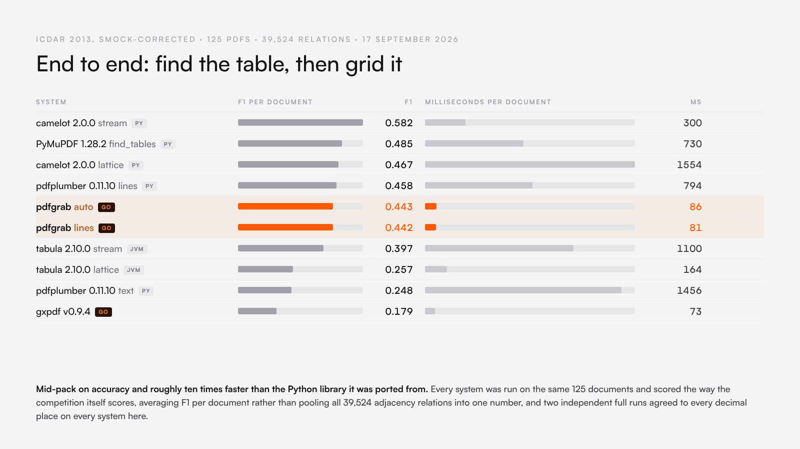
</p>

| System | Version | Precision | Recall | **F1 per document** | Pooled F1 | ms per document | p95 ms |
|---|---|---|---|---|---|---|---|
| camelot (stream) | 2.0.0 | 0.514 | 0.762 | **0.582** | 0.716 | 300 | 899 |
| PyMuPDF `find_tables` | 1.28.2 | 0.560 | 0.472 | **0.485** | 0.392 | 730 | 2116 |
| camelot (lattice) | 2.0.0 | 0.520 | 0.453 | **0.467** | 0.396 | 1554 | 3237 |
| pdfplumber (lines) | 0.11.10 | 0.558 | 0.440 | **0.458** | 0.370 | 794 | 2066 |
| pdfgrab (auto) | main | 0.548 | 0.422 | **0.443** | 0.358 | 86 | 274 |
| pdfgrab (lines) | main | 0.545 | 0.422 | **0.442** | 0.362 | 81 | 247 |
| tabula (stream) | 2.10.0 | 0.387 | 0.460 | **0.397** | 0.437 | 1100 | 2680 |
| tabula (lattice) | 2.10.0 | 0.258 | 0.339 | **0.257** | 0.107 | 164 | 415 |
| pdfplumber (text) | 0.11.10 | 0.188 | 0.559 | **0.248** | 0.267 | 1456 | 4043 |
| gxpdf (Go) | v0.9.4 | 0.201 | 0.176 | **0.179** | 0.293 | 73 | 213 |

pdfgrab is fifth of ten on accuracy, 0.016 below pdfplumber, the library it ports. It is the fastest system of comparable accuracy: 81 ms per document against pdfplumber's 794 and camelot lattice's 1554, in one static binary with no Python runtime. No system failed on any document. The whole table was produced twice in independent processes, and every per-document F1 agreed to every decimal place.

What these numbers do not show:

- **This is end to end, not structure only.** Published ICDAR 2013 figures of 0.85 to 0.95 hand the system the table region. A table missed at IoU below 0.5 counts every one of its relations as a false negative.
- **This is not the 67-PDF competition test set.** The 125 PDFs are the Smock-corrected superset (competition set plus the 2012 practice data), and the corrected ground truth is a slightly more forgiving target.
- **Adjacency relations only see non-blank cells,** compared by exact string after whitespace normalisation.
- **Reports before 2026-09-17 quote 0.362.** That was pooled F1 over every relation in the corpus, not the per-document average. The older reports are kept as written, with a note pointing to the correction.

### Where it sits in Go

<p align="center">
  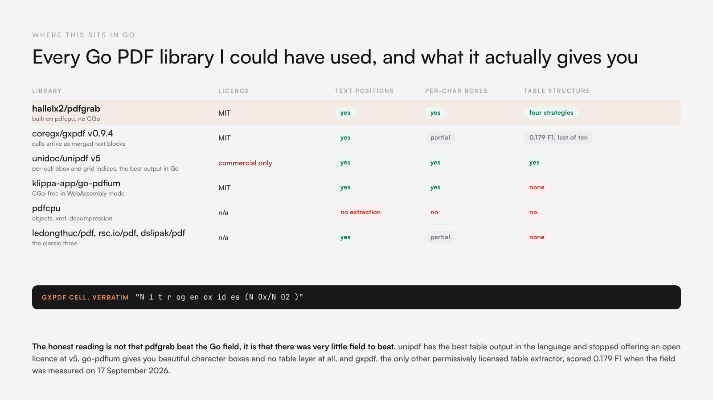
</p>

gxpdf's cells come back as merged text blocks with the glyph spacing unresolved, for example `"N i t r og en ox id es (N Ox/N O2 )"` from `eu-001.pdf`. That is the font-metrics problem pdfgrab fixed in August, showing up at the output layer. unipdf has the best table output in Go and could not be benchmarked without a commercial key.

### Where the error lives

<p align="center">
  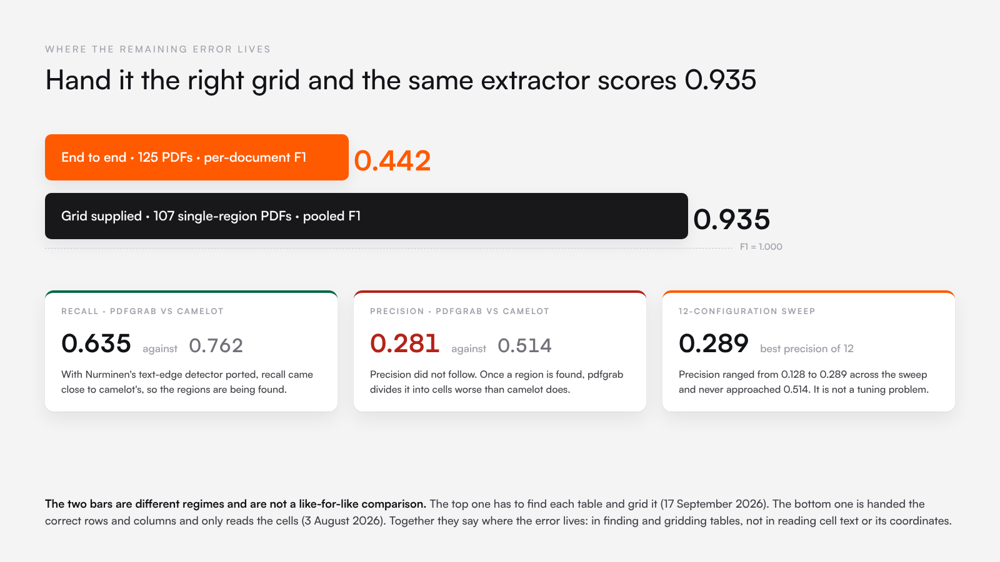
</p>

The two bars differ in regime, metric and corpus, as [the hybrid section](#7-the-hybrid-a-layout-model-gives-the-grid-pdfgrab-reads-the-cells) explains. The three cards are the [text-edge](docs/evaluations/2026-09-17-text-edge-region-detection.md) and [sweep](docs/evaluations/2026-09-17-region-gridding-threshold-sweep.md) results, all 2026-09-17.

### Negative results

Each of these was a hypothesis that the measurement rejected. They ship opt-in, or not at all.

| Hypothesis | Result | Date | Report |
|---|---|---|---|
| Choosing `text` on an axis without rules, when the other axis is ruled (`auto`), raises accuracy | Documents with no table found fell from 28 (22%) to 23 (18%), but pooled F1 went from 0.362 to 0.358. The newly found tables were gridded badly. Opt-in; `TestAutoIsNotTheDefault` keeps it so. | 2026-08-02 | [strategy-auto](docs/evaluations/2026-08-02-strategy-auto-negative-result.md) |
| A naive `lines`, then `text` fallback finds the missing tables | Pooled precision fell from 0.865 to 0.223, because prose aligns too. `auto` refuses to guess when neither axis is ruled for this reason. | 2026-08-02 | [icdar2013](docs/evaluations/2026-08-02-icdar2013-table-structure.md) |
| Porting Nurminen's text-edge detector closes the gap to camelot | Against the page-wide `text` strategy, F1 rose from 0.245 to 0.337 and time fell from 288 to 227 ms per document. Recall reached 0.635 against camelot's 0.762, but precision stayed at 0.281 against 0.514, and `lines` (0.442) still wins. Opt-in as `DetectRegions`. | 2026-09-17 | [text-edge-region-detection](docs/evaluations/2026-09-17-text-edge-region-detection.md) |
| The in-region precision gap is a threshold tuned for a whole page | Twelve configurations of padding and word thresholds. Precision ranged from 0.128 to 0.289; the best F1, 0.342, is noise against the 0.337 baseline. Lowering `MinWordsVertical` to 1 halved precision. The gap is in the gridding logic, not the settings. | 2026-09-17 | [region-gridding-threshold-sweep](docs/evaluations/2026-09-17-region-gridding-threshold-sweep.md) |

One method note from the sweep: a three-document smoke run put padding 2.0 first, at F1 0.628. Over all 125 documents the same configuration came sixth. A small sample is for checking that the harness runs, not for reading a result.

## Agreement with pdfplumber

These figures measure agreement with pdfplumber, not ground truth. pdfplumber is the reference pdfgrab ports, and in two places it is wrong (the Symbol encoding and the clipped parenthesis), so agreement is not correctness.

| Measure | Before | After | Date | Report |
|---|---|---|---|---|
| Horizontal word-position drift against pdfplumber, golden fixtures | 11.99 pt max, 4.79 pt mean | **0.0000 pt** | 2026-08-02 | [font metrics and table fidelity](docs/evaluations/2026-08-02-font-metrics-and-table-fidelity.md) |
| Vertical drift | 4.968 pt at 24 pt, 2.484 pt at 12 pt | **0.0000 pt** | 2026-08-02 | same |
| Tolerance the golden test asserts | 15 pt | **0.01 pt, both axes** | 2026-08-02 | same |
| Minus signs kept, 3M 2018 10-K, pages 56 to 60 | 83/103 | **103/103** | 2026-08-02 | same |
| Font coverage of the golden corpus | 1 font, 26 words | 12 fonts, 3 sizes, 170 words | 2026-08-02 | same |
| Table F1 against pdfplumber `lines`, ICDAR 2013 per document | | 0.442 against 0.458 | 2026-09-17 | [field comparison](docs/evaluations/2026-09-17-field-comparison-and-metric-correction.md) |

The minus-sign figure is the one place pdfgrab now does better than pdfplumber rather than matching it: pdfplumber drops the same parentheses. Findings in the font audit were confirmed against the page rendered with `pdftoppm`, poppler's `pdftotext -layout`, and pdfplumber 0.11.9. One reported defect, `"Consolidated Balance Shee t"`, turned out to be in the source document: the rendered page and poppler show the same gap.

What matches pdfplumber exactly: word grouping (the same line clustering and gap merge, defaults, blank-character filtering, ligature expansion and punctuation splitting), word order when `UseTextFlow` is off, and direction handling. What does not:

- **`Layout: true` text** is column-aligned with the same density defaults, but not byte-equal to pdfplumber's, whose layout output changes between releases.
- **Not ported:** `extract_text_lines`, `search` over the text map, and `ExtraAttrs` beyond `fontname` and `size`.
- **Coordinates** are PDF user space (`Y0`, `Y1`, origin bottom-left). pdfplumber reports `top` and `bottom` from the top-left. `top = page.Height() - Y1`.
- **Pages are 1-based**: `doc.Page(1)` is pdfplumber's `pdf.pages[0]`.
- **Rows are `[]string`**: a missing cell is `""`, not `None`.

## Limits

- **Scanned PDFs.** A scan has no text layer, so there is nothing to position. pdfgrab does no OCR.
- **CJK and composite fonts.** Type0 fonts are decoded as two-byte `Identity-H` codes, and vertical writing is not implemented. CID and Type0 fonts, which cover CJK and many modern subset fonts, are unmeasured (listed untested on 2026-08-02).
- **Embedded subset fonts.** Subset fonts that ship their own `/Widths` are the common production case and are unmeasured. A font with neither `/Widths` nor a recognised standard-14 name falls back to 500/1000 per glyph and will drift.
- **Rotated and multi-column layouts** are unmeasured.
- **Type 3 fonts** are not interpreted.
- **Table detection** is the weak half: on ICDAR 2013, `lines` finds no table at all in 22% of documents (28 of 125, 2026-08-02), because a table ruled on one axis has no crossings.
- **Encryption** (measured 2026-10-12 with AES-256 files made by qpdf): a PDF with only an owner password opens and reads normally. A PDF that needs a user password returns `ErrEncrypted`, and there is no way to pass a password. `TestEncryptedDocuments` pins both.
- **Concurrency** (measured 2026-10-12 with `go test -race`): opening and parsing documents from several goroutines at once is a data race, in pdfgrab's lazily built operator table and in pdfcpu's shared configuration. Serialise `Open` and page parsing until that is fixed (HAL-118).
- **Tags.** No tag exists under the `github.com/hallelx2/pdfgrab` module path. Use `@main` (HAL-2690).

## Where it is used

[vectorless-engine](https://github.com/hallelx2/vectorless-engine) uses pdfgrab for pincites, citations pinned to the exact line of a page. At ingest, `PDFLayout` in `pkg/parser/pdf_layout.go` reads every page's words with `XToleranceRatio` 0.15 and `UseExplicitSpaces`, groups them into lines, and stores each line's words with positions normalised to 0..1 of the page from the top-left. When an answer cites a quote, the engine finds the quote among those lines and draws one rectangle per line. The page text that retrieval reads is built from the same words, so a quote that matches the text also matches the geometry. The engine also uses `ExtractTables` for table sections.

The engine imports pdfgrab under its earlier module path, `github.com/hallelx2/pdftable` v0.4.0, and serialises `OpenBytes` behind a mutex because of the race above.

## API

The full reference is on [pkg.go.dev](https://pkg.go.dev/github.com/hallelx2/pdfgrab). The surface, abridged:

```go
// Open a document.
func Open(r io.Reader) (Document, error)
func OpenBytes(b []byte) (Document, error) // b is not copied; do not mutate it while in use
func OpenFile(path string) (Document, error)

type Document interface {
	NumPages() int
	Page(n int) (Page, error)    // 1-based
	Pages() iter.Seq2[int, Page] // for n, page := range doc.Pages()
	Close() error
}

type Page interface {
	Number() int
	Width() float64  // points, after /Rotate
	Height() float64

	// Primitives, in content-stream order.
	Chars() ([]Char, error)
	Lines() ([]Line, error)
	Rects() ([]Rect, error)
	Curves() ([]Curve, error)
	Objects() (Objects, error) // all four in one pass

	// Text.
	Words(opts WordOpts) ([]Word, error)
	ExtractText(opts TextOpts) (string, error)
	ExtractTextSimple(xTolerance, yTolerance float64) (string, error)

	// Tables.
	FindTables(settings TableSettings) ([]TableFinder, error) // geometry only
	ExtractTables(settings TableSettings) ([]*Table, error)
}

type Char struct {
	Text           string // "(cid:N)" when the code has no Unicode mapping
	X0, Y0, X1, Y1 float64
	FontName       string
	FontSize       float64
	Upright        bool
	Advance        float64
}

type Word struct {
	Text           string
	X0, Y0, X1, Y1 float64
	Upright        bool
	Direction      string // "ltr", "rtl", "ttb" or "btt"
	FontName       string
	FontSize       float64
	Chars          []Char // when WordOpts.KeepChars is set
}

type Table struct {
	Rows      [][]string // row 0 is the top row
	BBox      BBox
	Page      int
	CellsBBox [][]BBox // CellsBBox[i][j] is the box of Rows[i][j]
}

type BBox struct{ X0, Y0, X1, Y1 float64 }         // PDF user space
type ViewRect struct{ Left, Top, Width, Height float64 } // viewer space

func (b BBox) Viewport(pageHeight, scale float64) ViewRect
func (b BBox) Normalized(pageWidth, pageHeight float64) ViewRect

func DefaultWordOpts() WordOpts         // XTolerance 3, YTolerance 3, UseExplicitSpaces, Expand
func DefaultTextOpts() TextOpts         // adds XToleranceRatio 0.15, XDensity 7.25, YDensity 13
func DefaultTableSettings() TableSettings // pdfplumber's defaults, strategy "lines"
func DefaultTextEdgeOpts() TextEdgeOpts // MinLines 4, EdgeTol 50, CoordTol 0.5, MinTextLen 2, LineTol 2, PadLines 1
func DetectTextEdgeRegions(words []Word, opts TextEdgeOpts) []BBox

const (
	StrategyLines       TableStrategy = "lines"
	StrategyLinesStrict TableStrategy = "lines_strict"
	StrategyText        TableStrategy = "text"
	StrategyExplicit    TableStrategy = "explicit"
	StrategyAuto        TableStrategy = "auto"
)

// Sentinel errors, for errors.Is:
//   ErrInvalidPDF      the bytes are not a readable PDF
//   ErrPageOutOfRange  Page(n) with n < 1 or n > NumPages()
//   ErrUnsupported     a PDF feature pdfgrab does not implement
//   ErrEncrypted       the PDF needs a user password
var ErrInvalidPDF, ErrPageOutOfRange, ErrUnsupported, ErrEncrypted error
```

`TableSettings` fields and defaults: `VerticalStrategy` and `HorizontalStrategy` (`lines`), `SnapTolerance` 3, `JoinTolerance` 3, `EdgeMinLength` 3, `EdgeMinLengthPrefilter` 1, `IntersectionTolerance` 3, `TextTolerance` 3, `MinWordsVertical` 3, `MinWordsHorizontal` 1, `KeepBlankChars` false, `ExplicitVerticalLines` and `ExplicitHorizontalLines` (none), `MaxEdgesPerAxis` 1000, `MaxIntersections` 50000, `MergeSplitTokens` false, `DetectRegions` false, `TextEdge` (`DefaultTextEdgeOpts`). A zero field takes its default, so a struct literal with only the fields you need behaves like `DefaultTableSettings()` plus your changes.

## CLI

```sh
go install github.com/hallelx2/pdfgrab/cmd/pdfgrab@main
```

```sh
pdfgrab extract invoice.pdf --tables --format json            # every table on every page
pdfgrab extract 10k.pdf --tables \
    --vertical-strategy text --horizontal-strategy text \
    --min-words-vertical 4                                     # tables without rules
pdfgrab extract report.pdf --text --format text                # text only, \f between pages
pdfgrab extract report.pdf --tables --pages 1,3-5 --indent 2   # some pages, indented JSON
pdfgrab extract statement.pdf --tables \
    --vertical-strategy explicit --horizontal-strategy explicit \
    --explicit-vertical-lines 100,200,300,400 \
    --explicit-horizontal-lines 600,650,700,720                # a known grid
```

| Flag | Default | Description |
|---|---|---|
| `--pages` | all | Pages, as `1,3-5`. |
| `--tables` | off | Output detected tables. |
| `--text` | off | Output extracted text. |
| `--format` | `json` | `json` or `text`. |
| `--vertical-strategy` | `lines` | `lines`, `lines_strict`, `text` or `explicit`. |
| `--horizontal-strategy` | `lines` | The same set. |
| `--snap-tolerance` | 3 | Points. |
| `--join-tolerance` | 3 | Points. |
| `--edge-min-length` | 3 | Drop merged edges shorter than this. |
| `--edge-min-length-prefilter` | 1 | Drop raw edges shorter than this before merging. |
| `--intersection-tolerance` | 3 | Slack on edge crossings. |
| `--text-tolerance` | 3 | Per-cell text tolerance. |
| `--min-words-vertical` | 3 | `text` strategy column threshold. |
| `--min-words-horizontal` | 1 | `text` strategy row threshold. |
| `--explicit-vertical-lines` | none | Comma-separated x positions. |
| `--explicit-horizontal-lines` | none | Comma-separated y positions. |
| `--indent` | 0 | JSON indent; 0 is compact. |

## Versions

Checked 2026-10-11.

| | Module path | What it contains |
|---|---|---|
| `main` | `github.com/hallelx2/pdfgrab` | Everything below, plus the module rename (2026-08-21), the ICDAR metric correction and opt-in text-edge region detection (`DetectRegions`, `DetectTextEdgeRegions`), 2026-09-17. |
| 0.5.0 in [CHANGELOG](CHANGELOG.md) (2026-08-20) | | Standard-14 font metrics, glyph geometry, cell text at table edges, the first ICDAR 2013 evaluation. **Not tagged.** |
| `v0.4.0` tag (2026-07-03), the latest tag | `github.com/hallelx2/pdftable` | Size-relative word gaps, explicit spaces. |

Earlier: `v0.0.x` content-stream primitives; `v0.1.x` words and text extraction; `v0.2.x` table finding with `lines` and `lines_strict`; `v0.3.x` the `text` and `explicit` strategies and the CLI. The release history is in [CHANGELOG.md](CHANGELOG.md).

## Repository layout

`pdfgrab` is a single Go package, so its source sits in the repository root, which is the import path.

| Path | Contents |
|---|---|
| `*.go` | The library: `pdftable.go` (open), `pdf.go`, `page.go`, `char.go`, `text.go`, `table.go`, `finder.go`, `finder_text.go`, `detect_textedge.go`, `clustering.go`, `geometry.go`, `errors.go` |
| `internal/pdf/` | pdfcpu bridge, content-stream interpreter, text state, fonts, encodings, CMaps, the bundled Core 14 metrics |
| `internal/layout/` | Edge snapping, joining and filtering |
| `cmd/pdfgrab/` | CLI |
| `examples/` | A runnable table-extraction example |
| `bench/` | ICDAR 2013 harness; a separate Go module, so it adds no dependency here |
| `docs/evaluations/` | Dated measurement reports, with their caveats |
| `docs/media/` | The figures in this README |
| `scripts/` | Fixture and golden-file generators |
| `testdata/` | `golden/` (compared against pdfplumber), `fonts/` (fixtures where pdfplumber is wrong), `encrypted/` |

### Checks

[`.lorx/actions/ci.yml`](.lorx/actions/ci.yml) runs `gofmt`, `go vet`, `go build`, `golangci-lint` v2.14.0 and `go test -race` in containers. Run it locally with `bit run --all`. [`.github/workflows/test.yml`](.github/workflows/test.yml) runs `gofmt`, `go vet` and `go test -race` on Linux, macOS and Windows, but GitHub Actions on this account cannot start jobs (HAL-1712).

## Contact

halleluyaholudele@gmail.com

## License

MIT. See [LICENSE](LICENSE).

The bundled font-metric and glyph tables in `internal/pdf/` are generated from Adobe's Glyph List and Core 14 AFM data (BSD-3-Clause) and from pdf.js's encoding vectors (Apache-2.0). Attribution and the upstream licence texts are in [THIRD_PARTY_NOTICES.md](THIRD_PARTY_NOTICES.md).

pdfgrab ports algorithms from [pdfminer.six](https://github.com/pdfminer/pdfminer.six) and [pdfplumber](https://github.com/jsvine/pdfplumber). Their authors worked out how to recover structure from the PDF format; this is that work in Go.
